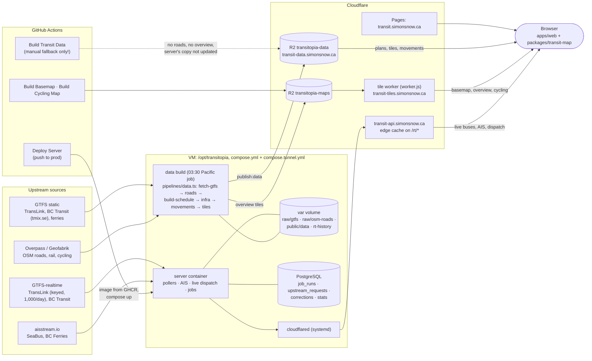

# Where to look when something's off

A map of a running copy (the hosts of [self-hosting.md](self-hosting.md), behind a Cloudflare Tunnel) and, for each symptom, the part to check first. How each part works is in its own doc: [README.md](README.md) (hosting, operations), [apps/server](../apps/server/README.md), [pipelines](../pipelines/README.md), [packages/transit-map](../packages/transit-map/README.md).

## The parts

The server reads its own copy of the published data (`var/public/data`), not R2. Its pollers map a bus's GTFS `route_id` to a route through the feed's plans there, so a feed whose plans the server hasn't built locally gets polled but shows no buses.

## What the browser loads, by zoom

| Zoom | Lines from | Vehicles from |
|---|---|---|
| Below 10 (~5 km scale bar) | Overview tileset `transit-overview-v<N>` (tile worker; `OVERVIEW_TILES_VERSION` in `packages/shared/src/transit-overview.ts`) | None: the engine is hidden |
| 10 and in | Each feed's plan tiles (`transit-data`, named in `plan.json` → `files.tiles`); bus corridors coloured by frequency need `corridors` in the plan | Live: `transit-api …/feeds/<feed>/live`; otherwise estimated from the plan's timetable |

## Symptom → where to look

Set this on the VM first: `cd /opt/transitopia && C="-f infra/compose.yml -f infra/compose.tunnel.yml"`. Always pass both files: plain `docker compose up -d` starts Caddy and leaves nothing on the port the tunnel uses.

| Symptom | Likely cause | Check |
|---|---|---|
| Whole site down, `transit-api` gives Cloudflare "error code: 502" | Server container not running, started without the tunnel file, or `cloudflared` down | `docker compose $C ps`; `curl -s localhost:8787/healthz` on the VM; `sudo systemctl status cloudflared` |
| Deploy failed with `Failed to activate service 'org.freedesktop.systemd1'` | VM starved (memory); systemd hung | `free -h`; `sudo systemctl daemon-reexec` or reboot, then `docker compose $C up -d` |
| Nothing drawn when zoomed out | Overview tileset for the current version not published, or a 404 cached at the edge | `curl -sI https://transit-tiles.simonsnow.ca/transit-overview-v<N>.json` and again with `?x=1`. 404 without the query only: purge that URL in Cloudflare. 404 both: `MAPS_PUBLISH_REMOTE` in `infra/.env`, and the server's `[jobs] data` log |
| One feed's buses missing, but its schedule shows | Server has no local plan for the feed (polls, but `vehicles: 0`), or its poll budget is capped | `curl -s https://transit-api.simonsnow.ca/rt/status`: compare `vehicles` with `busesOnTrips`, and `budget.capped`. `docker compose $C exec server ls var/public/data/feeds/<feed>` |
| All buses estimated (no "Buses live") | Server not polling (`RT_POLL`), or the site's `VITE_TRANSIT_API` wrong | `/rt/status` → `polling`; the site's build variables in Cloudflare Pages |
| Bus routes all thin grey, brand routes (99, R-lines) grey | Plan built without bus corridors (no OSM roads), e.g. by the fallback workflow | Plan's `files` should list `corridors`: `curl -s --compressed "https://transit-data.simonsnow.ca/<plan path>?x=1"`. On the VM: `exec server ls var/raw/osm-roads/<feed>` |
| Data didn't update / new feed has no data | The server's data build failed | `docker compose $C logs server \| grep '\[jobs\] data' \| tail -40`. A failed build retries an hour later; today's runs are in `job_runs` |
| Build fails: "Two routes have the key …" | An archived GTFS version has routes the feed's config doesn't expect (e.g. left from an older merged feed) | `var/raw/gtfs/<feed>/`: move the offending version, and its plan in `var/public/data/feeds/<feed>/`, aside |
| SkyTrain trains odd: teleports, stuck, wrong platforms | Track or dispatch data | `npm run validate:infra`, `npm run validate:plan` locally; `config/networks/skytrain/` |
| SeaBus or ferries not following AIS | aisstream key or vessel list | `/rt/status` (AIS section); `ais` in `config/feeds/<feed>/feed.json` |
| Basemap or cycling map missing | Their GitHub workflows, or the tile worker | Actions → Build Basemap / Build Cycling Map; `ALLOWED_ORIGINS` in the worker |
| Times off by an hour | Old tzdata in the runtime | The server refuses to start (`timezoneChecks`); locally see CLAUDE.md → Workflow |

## Habits that avoid most of these

- Don't run **Build Transit Data** while the server publishes: it uploads plans without corridors and no overview, and leaves the server's own copy (which live buses depend on) as it was. To rebuild, let the server's job run.
- After bumping `OVERVIEW_TILES_VERSION`, let the next server build publish before opening the site, or purge the new URL afterwards.
- After a merge from upstream, compare `config/feeds/` with upstream's (`git diff upstream/main -- config/feeds`): a feed's id can stay while what it covers changes, and old GTFS archives on the VM then no longer fit.
